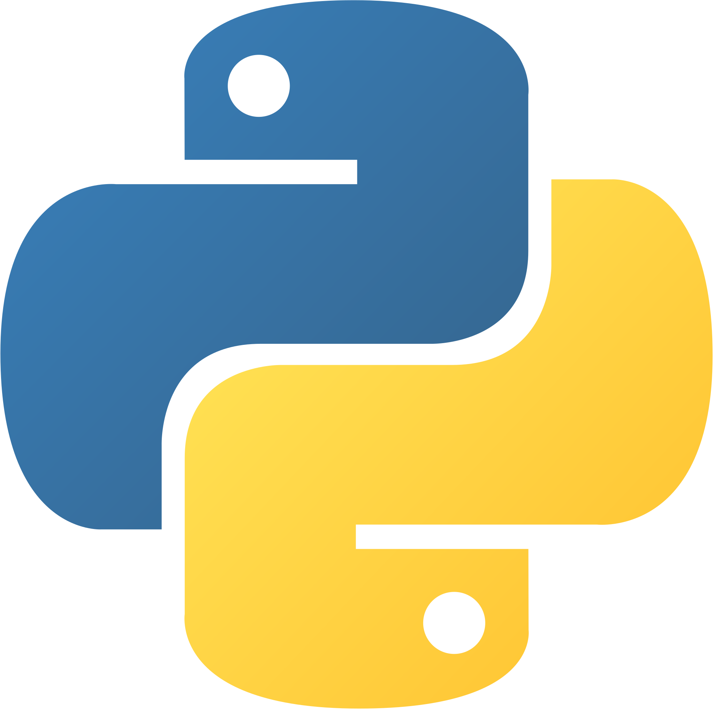
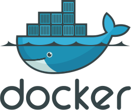
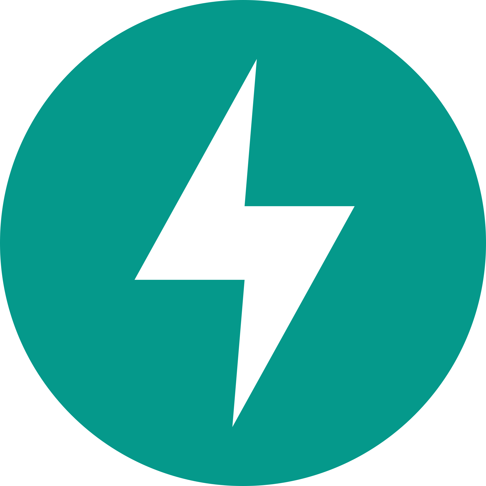

# Israel Villa · Senior Data Engineer 

**I build reliable data platforms and automate the processes that slow your business down.**
Diseño plataformas de datos confiables y automatizo los procesos que frenan a tu empresa.

🌐 **Portfolio:** [viillakc.github.io/VIILLAKC](https://viillakc.github.io/VIILLAKC/) · [English](https://viillakc.github.io/VIILLAKC/en/)
💼 [LinkedIn](https://www.linkedin.com/in/israel-v-8b50381b5) · 📍 Mexico City

---

Computer engineer with **4 years in production** building scalable pipelines, integrating heterogeneous systems and solving performance problems across telecom, manufacturing and healthcare. My core is Python, SQL, Spark/PySpark and Databricks with medallion architecture. I've shipped GenAI and ML models to production, led 4 engineers and mentored 6.

| ~30 | 80+ | 10M |
|:---:|:---:|:---:|
| production pipelines I built | pipelines shipped as a team | accounts processed per run |

## What I do

- ⚙️ **Process automation:** remove repetitive manual work and connect your systems.
- 🗄️ **Data pipelines & platform:** reliable, governed data that's ready for decisions.
- 🤖 **Applied AI & GenAI:** assistants and models that work on your own data.

**Open to:** Senior Data Engineer roles and business automation projects.

## Stack

    &nbsp;
    &nbsp;
    &nbsp;
    &nbsp;
    &nbsp;
    &nbsp;
    

 

## Education

- 🎓 Master's in Artificial Intelligence · UNIR (in progress, 2027)
- 🎓 B.Sc. in Computer Science (Informatics) · UNAM · FES Cuautitlán
- 📜 Diploma in Web Development for Business · UNAM

### Badges

    &nbsp;
    &nbsp;
    

---

This repo is also the portfolio source: Astro + Tailwind, bilingual ES/EN, content in JSON (<code>src/content/</code>), deployed to GitHub Pages behind Lighthouse CI. See <code>docs/PLAN.md</code>.
